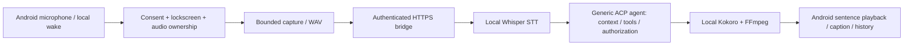

# Android voice-only ACP contract

## Responsibility boundary

Android does not interpret transcripts as commands or execute assistant-supplied actions. Requests such as asking the time, setting a timer or playing music are ordinary conversation sent to the agent; no semantic fast path exists. The generic bridge, not Android, connects to the ACP agent's socket or stdio transport. No Hermes, provider SDK, provider key, or bridge-owned integration is required by the Android client.

Removed: local schedules/timers/alarms, alert services and boot/time-change receivers, music-library/media command services, command routers, receipts, timer countdown/Cancel/Stop UI, library/alarm/media-playback permissions, and integration-confirmation UI and transport methods. Acoustic endpoint classes still use the upstream word “command”; they detect speech pauses and enforce microphone deadlines, not natural-language intent. Watchdogs, elapsed-time safety caps and reply audio playback remain.

## HTTPS voice contract

- Bearer-authenticated HTTPS origin only; normal hostname verification remains enabled. Optional imported CA replaces system trust. No redirects or automatic POST replay.
- `GET /v1/health` accepts protocol 1 (and upstream protocol 2) readiness. `POST /v1/conversations` creates a conversation only by explicit setup/new-conversation flow, never wake/recovery.
- `POST /v1/turns` uploads a bounded WAV once with `X-Conversation`, a durable `Idempotency-Key`, and `X-Audio-Chunks: sentence-mp3-v1`. A conversational follow-up is another ordinary upload with a fresh request key in the same conversation. No `X-Clarification-Parent` header is sent; the generic relay refuses that legacy extension.
- `GET /v1/turns/{turn}` polls with `X-Audio-After`; `GET /v1/turns/{turn}/audio[/{seq}]` retrieves bounded MP3 bytes. Android never follows model-supplied media URLs.
- `GET /v1/requests/{request}` is read-only recovery. `POST /v1/turns/{turn}/cancel` explicitly stops remaining speech/server work; it cannot undo agent actions.
- Optional explicitly tapped `POST /v1/diagnostics` sends the existing sanitized allowlist, not transcripts, raw IDs, URLs, tokens or audio. Share remains available if the bridge does not implement diagnostics.

`VoiceReply` is the common boundary for visible polling, offscreen polling, cancellation replies and status recovery. It admits only speech/text identity, state, transcript/detail, audio availability, sentence count, the explicit conversational reply marker and allowlisted numeric timings. Unknown fields are not forwarded to UI/state. Non-null legacy `phone_action` or `confirmation` envelopes, and action/unknown states, fail closed before audio, caption, follow-up capture or recovery acceptance. There is no receipt/confirmation POST or device-action executor. Legacy persisted `acting`/`confirming` phases become uncertain without changing request/conversation identity.

Speech states: `transcribing`, `thinking`, `speaking`, `done`, `error`, `cancelled`, `uncertain`. Ordinary assistant text is not parsed as JSON, action syntax or approval. The Lenovo opt-in follow-up window requires an explicit `reply_expected: true` marker, never question-mark inference or an app-side authorization mechanism. This generic relay emits no such marker, so it does not automatically reopen the microphone; the user explicitly starts the next ordinary voice turn. Android retains the bounded window for speech-compatible peers that emit the marker.

## Safety and upgrades

Retained: explicit persistent-wake consent and Stop, notification/privacy gates, locked-wake notification-only policy, assistant-role rules, one microphone/playback owner, native cleanup acknowledgment before rearm, model-only warmup, capture/playback deadlines, TLS and encrypted atomic pairing/history. Neither process restart nor lost network acknowledgment may replay audio or silently create/replace a conversation. Read-only recovery never downloads/replays reply audio or acknowledges a device action. The existing optional exact-approved local missing-request recovery remains disabled without its private build inputs; it is not integration approval and is not broadened here.

No state or schedule database is deleted or migrated by this refork. Historical local files are inert, not a supported schedule service. Before any separately authorized future device upgrade, the operator must stop old alerts/media and review existing scheduled state on the old app. This change does not install, cancel existing device schedules, reset pairing, rotate keys or deploy the bridge. Agent session durability and permissions belong to the bridge/agent and require their own validation.

Both upstream source variants remain: phone ARM64 “Hey Sarah” and Lenovo ARMv7 experimental “Nova”, including the Lenovo suppression trial, waveform and playback-position-paced caption. Package IDs, version declarations, model assets, private signing configuration and legal notices are not promoted to a new release or golden artifact.

## Regression coverage and validation limits

- Shared `tests/fixtures/voice-relay.json` is checked against real synthetic HTTP/ACP responses by Python and consumed by `VoiceReplyTest` via Gradle test resources. `BridgeFixtureTest` covers fresh follow-up keys without the rejected legacy header. The Kotlin checks remain unexecuted until JDK/SDK prerequisites exist.
- `VoiceReplyTest`: legacy action/approval/receipt rejection (including malformed values), allowed speech states and projected fields, arbitrary action-looking text/unknown fields remaining inert, and absence of action/confirmation transport/controller APIs.
- `SarahViewModelTest`: action/approval replies block before playback/caption/rearm in both manual/wake flows; old timer receipts cannot resolve uncertainty; persisted legacy action phases remain blocked. Existing sentence audio, wake, ownership, follow-up, Stop, TLS-fixture and read-only recovery tests are retained.
- `tests/test_voice_only_source.py`: five executable source-contract checks for manifest minimization, absent action/backend APIs, generic routes/TLS/no-replay controls, shared boundary wiring, and retained wake/audio/UI/storage paths. Run from repository root: `python -m unittest discover -s android/tests -v`. These checks passed; they do not execute Kotlin or prove device behavior.
- JVM tests and explicit phone/Lenovo APK builds were attempted with the documented Gradle commands but could not start: `JAVA_HOME` was unset and no `java` executable was available. No Android SDK was found in checked toolchain paths. No signing material was created or retrieved, and no APK was produced.
- An auxiliary tree-sitter Kotlin parse found no additional diagnostic fragments in changed/new files versus the upstream baseline; that parser also flags unchanged upstream syntax. It is not a Kotlin compiler or a substitute for JVM/build checks.
- No emulator/instrumentation, physical wake/capture/playback, live bridge/ACP/provider request, deployment or device install was performed. Upstream historical test/physical evidence and known JVM failures in `README.md` do not establish this refork's behavior or source-to-APK reproducibility.
